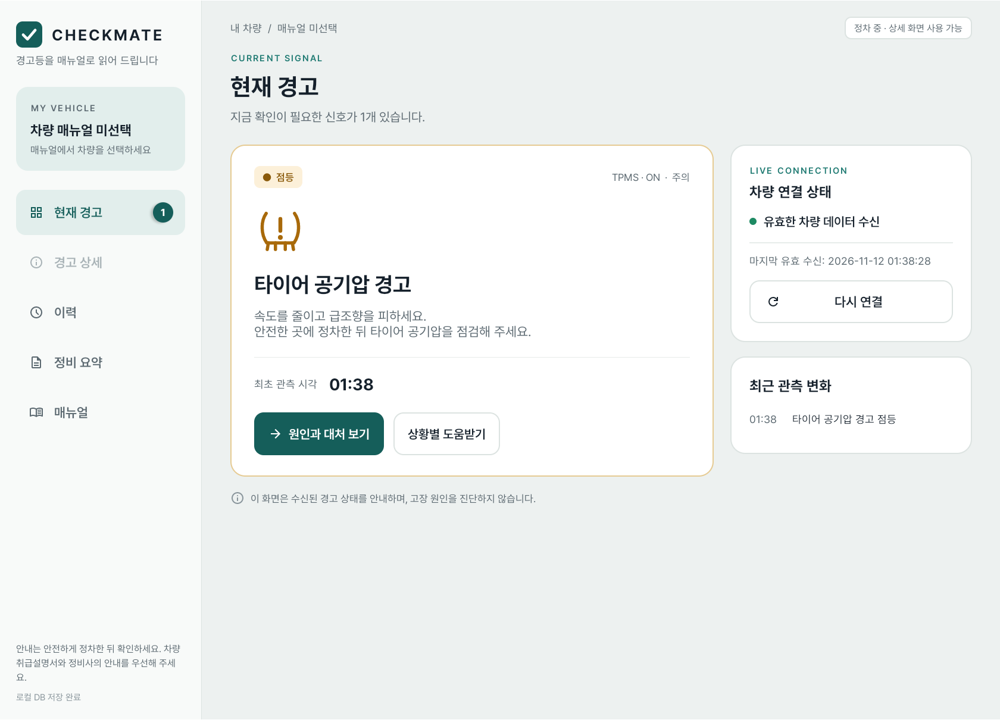
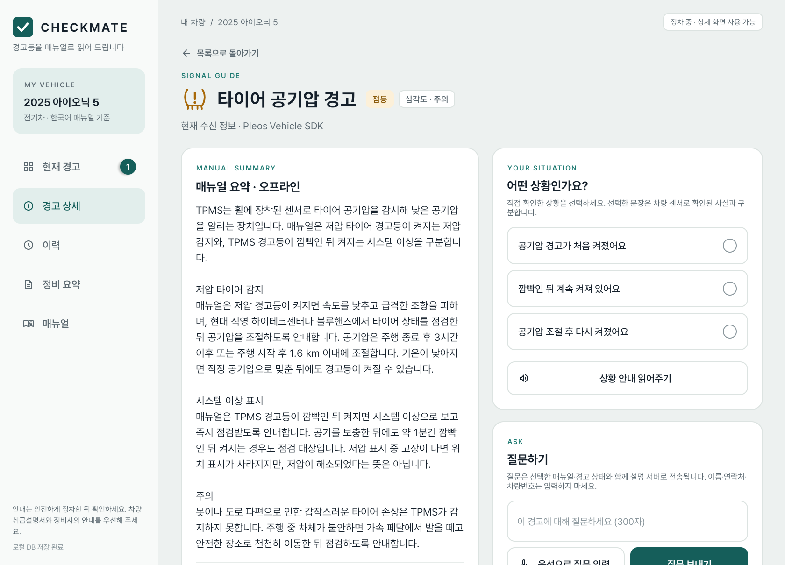
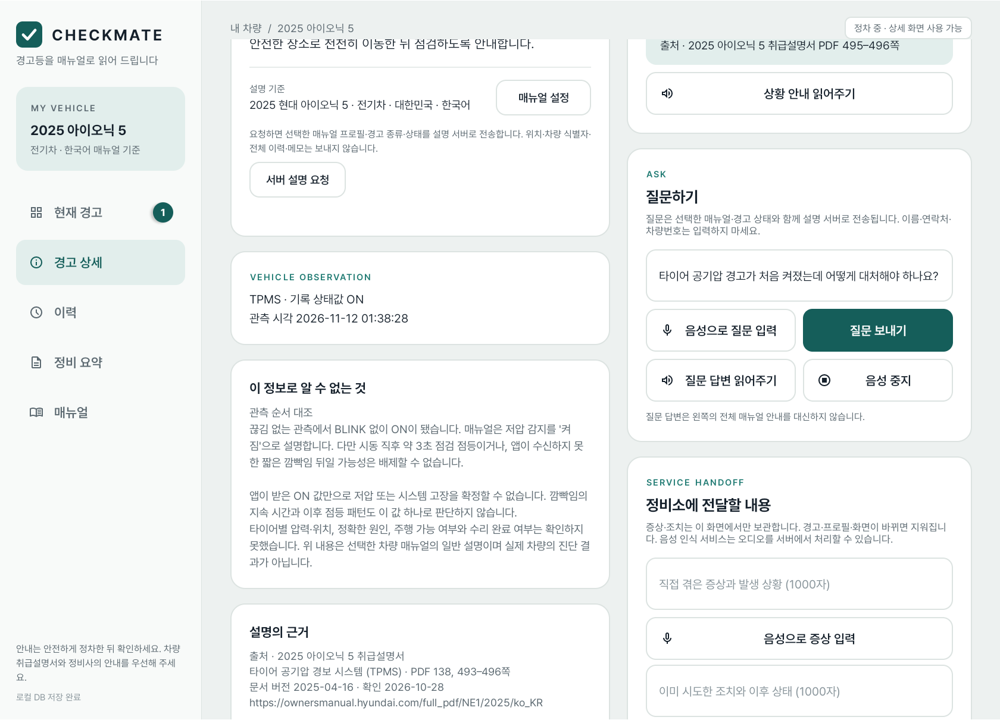
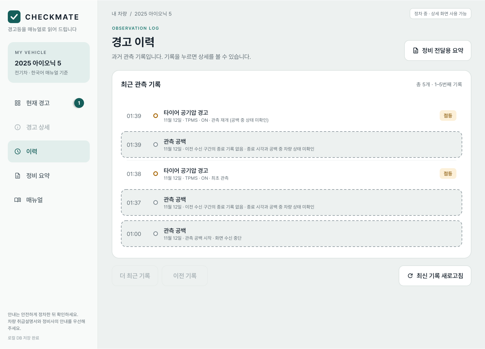
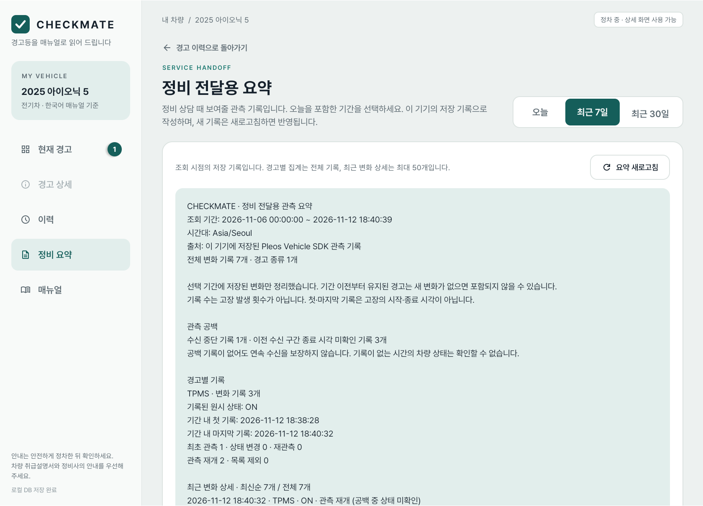

# CHECKMATE

**차량 경고등이 켜지면 취급설명서 근거로 원인과 대처를 안내하고, 경고 관측 이력을 정비소에 전달할 요청서로 정리해 주는 Pleos Connect 앱**



## 왜 만들었나

계기판 경고등이 켜지면 운전자는 "지금 계속 가도 되는지", "무엇을 확인해야 하는지"를 바로 알기 어렵습니다.
두꺼운 취급설명서를 차 안에서 찾아보기 힘들고, 정비소에 가서도 "언제부터, 어떻게 켜졌는지"를 정확히 설명하기 어렵습니다.

CHECKMATE는 Pleos Vehicle SDK로 **차량이 실제로 보낸 경고 신호**를 받아

1. 선택한 차량의 **공식 취급설명서 근거**로 원인과 대처를 보여 주고,
2. 운전자가 직접 확인한 상황을 고르면 상황별 안내와 질문 답변을 제공하고,
3. 경고가 언제 켜지고 바뀌었는지 **관측 이력을 기기에 저장**해,
4. 차량 관측 사실과 운전자 진술을 구분한 **정비 요청서**로 정리합니다.

고장을 진단하거나 차량을 제어하지 않습니다. 앱이 확인한 사실과 확인하지 못한 것을 구분해서 보여 줍니다.

## 주요 기능

| 화면 | 내용 |
|---|---|
| 현재 경고 | Vehicle SDK 실시간 수신. 경고별 카드(상태·심각도·최초 관측 시각), 차량 연결 상태, 최근 관측 변화 |
| 경고 상세 | 2025 아이오닉 5 취급설명서 요약과 출처(PDF 쪽수), 앱이 알 수 없는 것, 원문 링크 |
| 상황별 도움 | TPMS 3개·EPB 3개 상황 선택, 확인할 내용과 대처 안내, 음성 읽어주기(Pleos TTS), 질문하기 |
| 경고 이력 | Room DB에 저장된 관측 기록. 관측 공백(앱이 수신하지 못한 구간)을 따로 표시 |
| 정비 요약·요청서 | 오늘/7일/30일 집계, 정비소 공유용 요청서 미리보기와 공유, 현대 공식 정비소 찾기 |
| 주행 중 제한 | `CarUxRestrictions`로 주행 중 상세 화면 차단, 정차 후 복귀 |

| 경고 상세 | 상황별 도움 |
|---|---|
|  |  |

| 경고 이력 | 정비 전달용 요약 |
|---|---|
|  |  |

### 사용한 Pleos SDK

- **Vehicle SDK 2.3.2**: 경고등(telltale) 목록 초기 조회와 실시간 리스너, 화면 종료 시 해제
- **TextToSpeech 3.3.1**: `ON_DEVICE`·한국어로 상황 안내와 질문 답변 읽기, 중지 확인 후 연결 해제
- **Car UX Restrictions**: 주행 상태에 따른 상세 화면 차단

## 시험 환경

| 항목 | 값 |
|---|---|
| 에뮬레이터 | **Pleos Connect Emulator v2.1.0** (`system-images;android-34;pleos_car_emulator;x86_64`) |
| Android | API 34 (Automotive) |
| 화면 사양 | **2560 × 1440, mdpi(160dpi), 12.8인치** (기기 프로필 `Pleos_Connect_v2_0`) |
| AVD 설정 | RAM 4GB, Cold boot, 그래픽 Hardware |
| 앱 SDK | `minSdk` 28, `targetSdk`·`compileSdk` 35 |
| 빌드 도구 | Android Studio 2026.2.2 (내장 JDK), Gradle 9.6.0, AGP 9.4.1, Kotlin |
| 개발 OS | Windows 11 |

에뮬레이터 설치는 [Pleos 공식 안내](https://document.pleos.ai/docs/connect/guide/getting-started/application-development/setup-connect-sdk-emulator)를 따릅니다.
SDK Manager의 SDK Update Sites에 아래 주소를 추가한 뒤 API 34의 Pleos Connect 이미지를 설치합니다.

```text
https://nexus-playground.pleos.ai/repository/raw-releases/connect-avd/2.x/crp-sys-img.xml
```

## APK

- 위치: [`apk/박건령_CHECKMATE_release.apk`](apk/%EB%B0%95%EA%B1%B4%EB%A0%B9_CHECKMATE_release.apk)
- 서명된 release 빌드, 버전 1.0.0 (versionCode 3), 패키지 `com.checkmate.pleos`, 약 31MB
- SHA-256 `f6e15f633a66d484c40e50ea2d1ffbb9405c6a548fbe032be0fcb00a200a0d99`
- Pleos Connect Emulator v2.1.0에 설치·실행해 Vehicle SDK 수신, 경고 카드, 상세 화면 동작을 확인했습니다 (2026-11-12).
- 설치 후 앱 목록의 **CHECKMATE**로 실행합니다. 같은 패키지의 debug 앱이 설치되어 있으면 서명이 달라 먼저 제거해야 합니다.

## 실행 방법

### 1. 설치와 실행

```powershell
adb install -r "apk/박건령_CHECKMATE_release.apk"
adb shell am start -n com.checkmate.pleos/.MainActivity
```

### 2. 경고 신호 넣기 (Virtual Console)

```powershell
adb forward tcp:8088 tcp:8088
```

PC 브라우저에서 `http://127.0.0.1:8088/`을 열고 경고등(Telltale) 상태를 바꿉니다.

### 3. 시연 순서

1. 기어 **P**, 속도 **0** 상태에서 앱을 엽니다. 차량 연결 상태에 "유효한 차량 데이터 수신"이 표시됩니다.
2. 사이드바의 **매뉴얼**에서 `2025 현대 아이오닉 5`를 선택합니다.
3. Virtual Console에서 **TPMS → On**을 누릅니다. 현재 경고에 "타이어 공기압 경고" 카드가 나타납니다.
4. **원인과 대처 보기**를 누르면 매뉴얼 요약과 출처가 나옵니다.
   오른쪽에서 "공기압 경고가 처음 켜졌어요"를 고르고 **상황 안내 읽어주기**로 음성 안내를 듣습니다.
5. 증상을 적고 **정비 요청서 미리보기**를 누르면 차량 관측 사실·운전자 진술·최근 7일 집계가 담긴 요청서가 나옵니다.
6. **이력**에서 기록을, **정비 요약**에서 기간별 집계를 확인합니다.
7. 기어를 **D**, 속도를 **30**으로 바꾸면 상세 화면이 가려지고, 다시 P·0으로 돌리면 복귀합니다.

다른 시나리오: TPMS **Blink → On**(시스템 이상 안내, 심각도 "즉시 점검"), **ElectronicParkingBrake → On**(EPB 안내).

### 질문하기(AI 답변) 기능

질문 답변은 이 저장소의 `backend/` 설명 서버가 필요합니다. 서버는 취급설명서 근거를 bge-m3·Qdrant로 검색하고,
근거가 부족하면 답하지 않습니다. 서버 없이도 매뉴얼 요약, 상황별 안내, 이력, 요청서는 모두 동작합니다.

- **release APK**는 HTTPS 서버 주소로 빌드해야 질문 기능이 켜집니다. 제출 APK는 서버 주소 없이 빌드되어
  질문 버튼에 "질문 서버가 설정되지 않았습니다"가 표시됩니다.
- **debug 빌드**는 `http://127.0.0.1:8000`을 사용합니다. 로컬 서버를 띄우고 `adb reverse tcp:8000 tcp:8000`으로 연결합니다.
  자세한 방법은 [`backend/README.md`](backend/README.md)를 참고하세요.

```powershell
# backend 폴더, GPU 없이 실행
$env:CHECKMATE_GENERATION = 'reviewed'
$env:CHECKMATE_RETRIEVAL = 'qdrant'
$env:OLLAMA_EMBED_NUM_GPU = '0'
uv run uvicorn checkmate.main:app --host 127.0.0.1 --port 8000
```

Windows에서는 에뮬레이터·서버·포트 연결·앱 설치를 한 번에 하는 `START.cmd`(`scripts/Start-Checkmate.ps1`)도 사용할 수 있습니다.

## 소스에서 빌드

1. Android Studio에서 **`android` 폴더**를 엽니다. Gradle JDK는 Android Studio 내장 JDK를 사용합니다.
2. Gradle Sync 후 Pleos 에뮬레이터를 부팅하고 `app`을 실행합니다.

```powershell
cd android
.\gradlew.bat :app:assembleDebug :app:testDebugUnitTest
```

Pleos SDK는 `https://nexus-playground.pleos.ai/repository/maven-releases/`에서 받습니다(`settings.gradle.kts`에 설정됨).
서명 키, `keystore.properties`, `local.properties`는 저장소에 올리지 않습니다.

## 프로젝트 구조

```text
android/        Android 앱 (Kotlin, XML View)
  app/src/main/java/com/checkmate/pleos/
    vehicle/      Vehicle SDK 수신, 주행 제한
    history/      Room DB 관측 이력
    manual/       매뉴얼 프로필과 경고별 검토 요약
    assistance/   상황별 안내, 음성(TTS), 정비 요청서
    summary/      기간별 정비 요약
    explanation/  설명 서버 연동
    ui/           공통 UI 요소, 경고 표시 라벨
backend/        설명 서버 (FastAPI, LangGraph, Qdrant, Ollama bge-m3)
scripts/        Windows 통합 실행, 시나리오 검증
data/           매뉴얼 조사·검토 자료
screenshots/    README 화면 캡처
```

## 검증 현황

- Android 단위 테스트 47개 통과 (2026-11-12, UI 개편 후 재실행)
- 2026-11-08 Pleos 에뮬레이터 실연동 시나리오 3개 통과: TPMS 최초 점등, TPMS 깜빡임→점등, EPB 지속 점등
  (Virtual Console → Vehicle SDK → 상황 안내 → 질문 답변 → 이력 기반 요청서)
- backend 테스트 57개 통과 (2026-11-08)
- 상세 기록은 [`DEVELOPMENT.md`](DEVELOPMENT.md)에 있습니다.

## 한계

- 매뉴얼 안내는 **2025 아이오닉 5 한국어 취급설명서의 TPMS·EPB**만 지원합니다. 다른 경고는 관측 기록만 남깁니다.
- 에뮬레이터 검증이며 실차 검증이 아닙니다. 앱의 상태값만으로 고장 원인이나 주행 가능 여부를 판단하지 않습니다.
- 정비소 자동 접수·예약 연동은 없습니다. 요청서는 사용자가 공유 앱으로 직접 보냅니다.
- 음성 입력은 Android 기본 음성 인식을 사용합니다(Pleos STT 미연동).

## 출처와 라이선스

- 매뉴얼: [2025 아이오닉 5 취급설명서](https://ownersmanual.hyundai.com/full_pdf/NE1/2025/ko_KR) (현대자동차). 원문을 복제하지 않고 검토 요약과 쪽수만 사용합니다.
- 글꼴: [Pretendard](https://github.com/orioncactus/pretendard) — SIL Open Font License 1.1 ([`android/app/licenses/Pretendard-OFL.txt`](android/app/licenses/Pretendard-OFL.txt))
- 아이콘: [Material Symbols](https://github.com/google/material-design-icons) — Apache License 2.0. TPMS·EPB 경고등 아이콘은 직접 그렸습니다.
